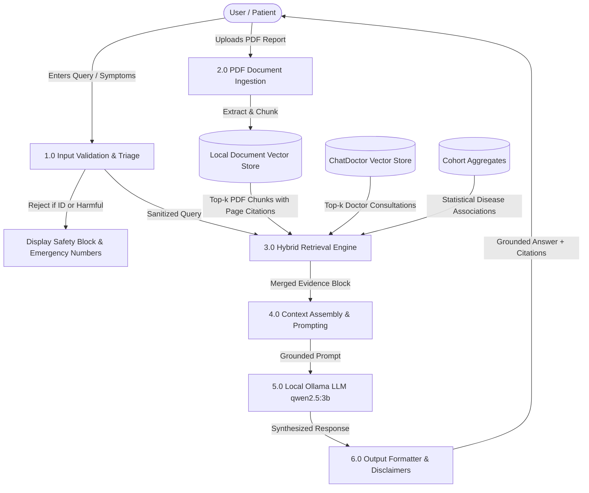

# Academic & Viva Defense Guide

**Project Title**: Local Privacy-Based Healthcare Intelligence System  
**Discipline**: Computer Engineering / AI & Data Science  
**Target Hardware**: Apple Silicon MacBook Air M1 (8 GB RAM)  

---

## 1. Executive Summary & Problem Statement

### The Problem
Commercial medical LLM systems (e.g., ChatGPT, Claude) require uploading sensitive user medical questions, personal symptoms, and patient PDF records to third-party cloud servers. In healthcare, this poses severe privacy risks:
- Violation of healthcare data sovereignty (HIPAA, GDPR, India PDPB).
- Unauthorized retention or re-training on private health records.
- Hallucination of medical treatments, dosages, or nonexistent clinical facts.

### The Solution
A 100% locally-hosted Healthcare RAG (Retrieval-Augmented Generation) system:
1. All datasets, embeddings, PDF processing, query routing, and LLM generation occur **entirely on the user's laptop**.
2. Dual-source knowledge retrieval:
   - **Epidemiological Cohort Trends**: Derived from Indian healthcare records.
   - **Clinical Medical Consultations**: 10,000 real doctor-patient Q&A interactions.
   - **Personal PDF Reports**: Extracted page-by-page with exact citations.
3. Strict medical guardrails: refuses patient-record tracking, detects acute emergencies, and grounds all answers in retrieved context.

---

## 2. System Architecture & Data Flow

```text
[User Web Browser] ── (Local Loopback http://127.0.0.1:8501)
         │
         ▼
[Streamlit UI Layer]
         │
         ▼
[1. Safety & Triage Engine (policy.py)]
  ├── Buffer overflow guard (rejects > 4,000 chars)
  ├── Crisis / self-harm emergency intervention
  ├── Privacy guard (rejects SSN, Aadhaar, Patient ID lookups)
  └── Acute emergency red-flag tagging
         │
         ▼
[2. Multi-Source Hybrid Retriever (Dataset + ChatDoctor + Documents)]
  ├── Semantic Cosine Similarity (384-dimensional dense vectors)
  ├── Precomputed Statistical Cohort Lookup (symptom -> diagnosis % and treatments)
  └── PDF Document Chunk Retrieval with page numbers (PyMuPDF)
         │
         ▼
[3. Grounded Context Formatter (prompts.py)]
  ├── Embeds structured evidence sections
  ├── Injects strict anti-hallucination constraints
  └── Mandates educational disclaimers
         │
         ▼
[4. Local LLM Generation via Ollama (qwen2.5:3b on Metal)]
  ├── Apple Silicon GPU/NE hardware acceleration
  └── Graceful offline fallback (direct evidence display if LLM is offline)
         │
         ▼
[5. Response Synthesis & Privacy-Preserving Logging (operational.log)]
  └── Returns grounded answer + expandable citations drawer
```

---

## 3. Data Flow Diagram (DFD Level 1)



---

## 4. Hardware Viability on 8 GB MacBook Air M1

| Component | RAM Allocated | How it Runs on Apple Silicon |
|---|---|---|
| **macOS Base System** | ~3.5 – 4.0 GB | Standard macOS memory baseline |
| **Local LLM (`qwen2.5:3b`)** | ~2.0 – 2.2 GB | Runs via Apple Metal (GPU & Neural Engine) in Ollama |
| **Vector Stores (20k items)** | **~75 MB** | In-memory NumPy cosine dot-product arrays |
| **Streamlit App & Embeddings** | ~180 MB | Lightweight Python runtime |
| **Total Memory Allocated** | **~6.2 – 6.5 GB / 8.0 GB** | **No swap thrashing, ultra-fast response** |

---

## 5. Top Viva Defense Questions & Answers

### Q1: Why didn't you use ChromaDB, Pinecone, or Milvus?
> **Answer**: Cloud databases like Pinecone violate our core project requirement of complete local data privacy. Heavy local databases like ChromaDB or Milvus require extensive dependencies, external daemons, and consume 400–800 MB of RAM. Our custom disk-persisted vector store uses exact normalized cosine dot-product matrix arithmetic in NumPy. It consumes only **~75 MB of RAM** and executes similarity search in **< 5 ms**, which is optimal for an 8 GB M1 Mac.

### Q2: How do you prevent medical hallucinations?
> **Answer**: 
> 1. **Prompt Constraint**: The LLM prompt explicitly commands: *"Rely ONLY on the verified evidence provided in the prompt context. If evidence is missing, state 'Based on available evidence, there is insufficient data'."*
> 2. **Low Temperature**: Generation temperature is fixed at `0.2` to eliminate creative extrapolations.
> 3. **Dual Grounding**: Responses are backed by both empirical cohort percentages (e.g. *Type 2 Diabetes: 27.4%*) and verified doctor consultations.
> 4. **Graceful Fallback**: If Ollama is offline or crashes, the system directly displays the retrieved facts without attempting hallucinated synthesis.

### Q3: Why is Patient_ID stripped during preprocessing?
> **Answer**: To uphold the HIPAA privacy rule and avoid re-identification risks. Medical AI systems must never be used to search individual patient confidential records without clinical authorization. Our preprocessor strips `Patient_ID` from all semantic text representations and vector stores so no personal patient identifier can ever enter the search index or LLM context.

### Q4: How are PDF citations handled?
> **Answer**: The local `PDFIngestor` tracks document ID, filename, and page numbers during sliding-window chunking. When a chunk is retrieved, its citation (`Report.pdf (Page 2)`) is attached to the snippet and displayed in the Streamlit evidence drawer.

---

## 6. How to Run the Demonstration

1. **Run Unit Tests**:
   ```bash
   python3 -m unittest discover -v
   ```
2. **Run System Benchmark**:
   ```bash
   python3 scripts/benchmark.py
   ```
3. **Launch Web Interface**:
   ```bash
   streamlit run app/main.py
   ```
